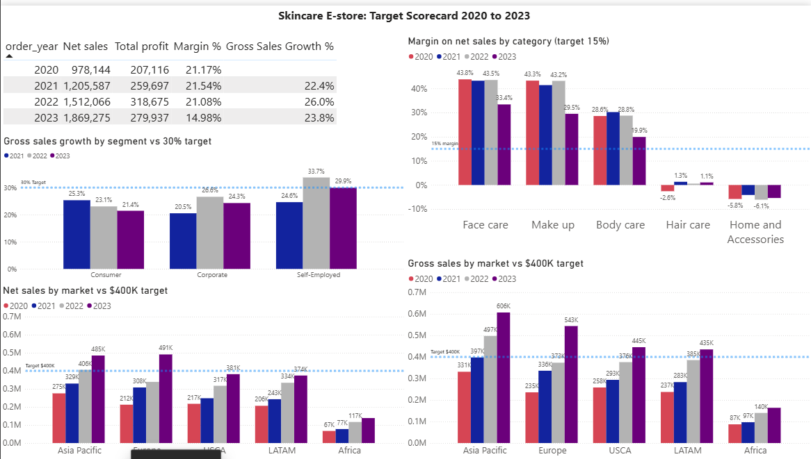
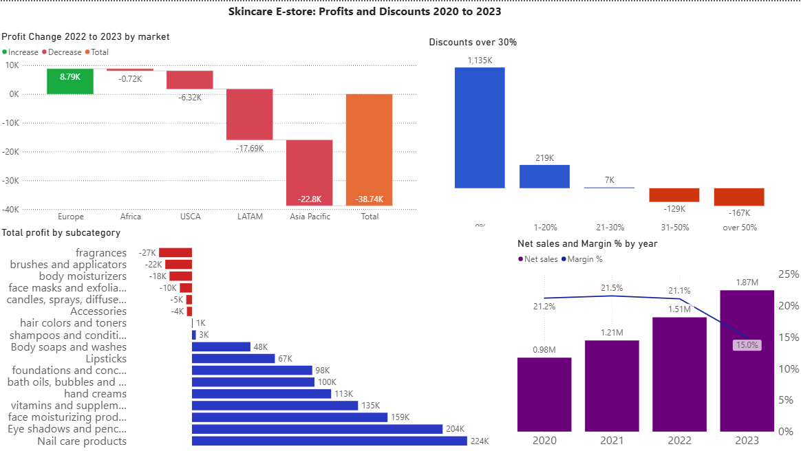

# Skincare-Ecommerce-Profitability-Analysis

### Dashboard : not published online; screenshots below (the Power BI file is not included because it embeds the dataset)

## Problem Statement

A global skincare and beauty e-store wants to know whether it is hitting its commercial targets and where profit is being made or lost. The business set four targets:

- Average profit margin of at least **15%** in every product group
- Annual sales growth of at least **20%**
- Corporate-segment sales growth of at least **30%**
- At least **$400K** in sales per market per year

Who is the stakeholder? The Head of E-commerce and the Finance Director.
What decision do they face? Where to cut discounts and which markets and categories to fix to reach next year's targets.

This project answers five questions:

1. Which targets were hit or missed each year, and by how much?
2. Where is profit made and lost (category, subcategory, market, segment)?
3. Is discounting destroying margin, and what caused the 2023 margin drop?
4. Which markets and countries are under $400K, and what is the gap?
5. How repeat-heavy is the customer base? (supporting analysis only, see limitations)

## Data

| Item | Detail |
|---|---|
| Source | FP20 Analytics Challenge 19 (public challenge dataset). I did not take part in the challenge; I used the dataset and its business questions to build this project. |
| Size | 51,290 order lines, 19 columns, one flat table |
| Period | 1 Jan 2020 to 31 Dec 2023 (four full years) |
| Scope | 25,728 orders, 17,415 customer IDs, 164 countries, 5 markets, 5 categories, 17 subcategories |

**Important:** this data is relabelled or synthetic (see the cleaning log). It does not describe a real company. The raw file is not included in this repo; download it from the source above and place it in `data/raw/`.

### Known limitations
- No cost of goods, returns, shipping or delivery, marketing or channel data. Only profit is given.
- Dates have a day only, so there is no time-of-day analysis.
- Latitude and longitude are country centroids, so maps show one dot per country.
- Profit margins follow a small set of fixed values, which is not realistic for a real store.
- The data cannot show *why* a margin changed, only where it changed.
- Customer ID is not a reliable person identifier (see cleaning log). Customer counts and repeat rates are approximate.
- Product names are not tied to categories, so analysis is at category and subcategory level only.

## Data Cleaning Process and EDA

The data had no null values, but a full audit found several quirks. Each check is a SQL query in `sql/02_audit.sql`. The raw table `raw_orders` was never edited; all changes were made in a separate table, `clean_orders`.

| # | Check | What I found | Decision | Rows affected |
|---|---|---|---|---|
| 1 | Duplicates | 2 pairs of rows identical in every field except Row ID, within the same order | Flagged as probable duplicates, excluded from analysis, not deleted | 2 |
| 2 | Product vs category | 3,440 of 3,577 products appear under more than one category | Analyse at category and subcategory level only | Most rows |
| 3 | Order ID vs date | Order IDs say 2012 to 2015, dates say 2020 to 2023: an exact 8-year shift | Kept order date as given, documented as synthetic or relabelled | All 51,290 |
| 4 | Sales basis | Sales is the price before discount (unit price is constant per product while discount varies); Profit is after discount | Added `net_sales = sales * (1 - discount)`; headline margin is profit / net sales | All |
| 5 | Multi-customer orders | 11 orders (35 rows, $3,591 sales) carry 2 customer IDs that differ only in the last digit | Flagged, not changed | 35 |

**Wider customer ID issue:** there are 17,415 distinct customer IDs, but 12,043 if the last digit is ignored. The share of single-order customers is 68.8% by full ID and 49.7% ignoring the last digit. I could not determine which is right, so customer metrics use the ID as given and are labelled approximate.

**Margin definition:** margin is reported on net sales (what the customer paid). Margin on gross sales is shown for reference, because the brief does not state which basis its 15% target uses.

## Steps followed

- Step 1 : Loaded the `data` sheet of the Excel file into a SQLite database (`E-commerce.db`) with a Python script (`src/load_data.py`), as table `raw_orders`. Column names were converted to snake_case and dates stored as YYYY-MM-DD text.
- Step 2 : Verified the import: 51,290 rows, dates from 2020-01-01 to 2023-12-31, total sales about 6,517,674 and total profit about 1,065,414.
- Step 3 : Ran the five audit checks above (`sql/02_audit.sql`) and recorded the results in the cleaning log.
- Step 4 : Built `clean_orders` (`sql/01_clean_orders.sql`) with flag columns for probable duplicates and multi-customer orders, plus `gross_sales`, `discount_amount` and `net_sales`.
- Step 5 : Verified `clean_orders`: 51,290 rows, 2 duplicate flags, 35 multi-customer rows, gross sales 6,517,674 and net sales 5,565,083. My first version flagged 9 duplicates because the duplicate rule was too loose; tightening it to "identical in every field except Row ID" gave the correct 2.
- Step 6 : Yearly scorecard in SQL (`sql/03_analysis.sql`): net sales, profit, margin on net sales and sales growth for each year.
- Step 7 : Investigated the 2023 margin drop (also in `sql/03_analysis.sql`) by category, subcategory, discount band and market, and measured the exact profit change by market (the five markets sum to the company's total change of -$38,738).
- Step 8 : Built an Excel scenario for a 30% discount cap (`models/discount_cap_scenario.xlsx`). The share of capped sales that still happen is an input cell, because the data cannot answer it.
- Step 9 : Exported `clean_orders` to `data/processed/clean_orders.csv`, loaded it into Power BI, fixed the column types, removed the 2 duplicate rows, and built two report pages (target scorecard; profit and discounts). Totals matched the SQL results.
- Step 10 : Saved dashboard screenshots to `images/`. Publishing to Power BI Service is optional and not done.

## Key findings

1. **Sales grew above target, but profit fell in 2023.** Gross sales grew 22.4%, 26.0% and 23.8% in 2021 to 2023 (target 20%). In 2023, profit fell 12.2% (from $318,675 to $279,937) and margin on net sales dropped from 21.1% to 15.0%.
2. **Discounts above 30% lose money every year.** Those lines lost $295.7K over four years, including $112.2K in 2023 on $224.4K of net sales. Without them, 2023 profit would have been about $392K.
3. **Two categories miss the 15% margin target every year.** Hair care earned 0.6% to 1.3% (and -2.6% in 2020), and Home and Accessories lost money in all four years, about $57.2K in total.
4. **Asia Pacific and LATAM drove the 2023 profit decline.** Profit changed by -$22.8K in Asia Pacific and -$17.7K in LATAM, while Europe rose $8.8K. Asia Pacific's margin fell from 19.6% in 2021 to 9.0% in 2023.
5. **Corporate and market targets were mostly missed.** Corporate growth was 20.5%, 26.6% and 24.3% against a 30% target. Africa never reached $400K, and LATAM and USCA pass only on gross sales in 2023.

## Recommendations

1. **Cap discounts at 30%.** In the Excel scenario, 2023 profit rises by an estimated $112K to $121K (40% to 43% of 2023 profit) and margin moves from 15.0% to roughly 20% to 24%. The profit gain holds even if every capped sale is lost. Net sales fall unless at least about 69% of those sales still happen at the capped discount. Assumption: retained sales earn the 21-30% band's 2023 margin of 2.6%.
2. **Investigate Asia Pacific first.** It is the largest and fastest-growing market, yet it lost $22.8K of profit in 2023 as its margin fell to 9.0%. The data has no cost fields, so the cause needs cost and pricing data.
3. **Review the six loss-making subcategories** (fragrances, brushes and applicators, body moisturizers, face masks and exfoliators, candles, sprays and diffusers, and Accessories), which lost about $85K combined over four years. Check their pricing and costs before deciding to fix or drop them.
4. **Define the targets precisely.** The brief does not say whether sales and margin targets are gross or net. The answer changes whether LATAM and USCA meet $400K, and whether 2023 margin is above or below 15%.

## Approach

SQL (SQLite) for auditing, cleaning and metrics, with the raw table left untouched. Excel for the discount-cap scenario. Power BI for the dashboard. Analysis is at category and subcategory level because of the product-category mismatch. Margins are on net sales; growth and the $400K market comparison are shown on gross sales, with a net-sales version alongside.

## Dashboard

Page 1: target scorecard.

Page 2: profit and discounts.

## Insights

### [1] Target scorecard

| Target | 2021 | 2022 | 2023 | Met? |
|---|---|---|---|---|
| Sales growth of at least 20% (gross) | 22.4% | 26.0% | 23.8% | Yes, every year |
| Corporate growth of at least 30% (gross) | 20.5% | 26.6% | 24.3% | No, every year |
| Margin of at least 15% in every category (net) | Hair care 1.3%, Home and Acc. -4.1% | Hair care 0.6%, Home and Acc. -6.1% | Hair care 1.1%, Home and Acc. -5.4% | No, 2 of 5 categories below 15% every year |
| At least $400K per market (markets above target) | 0 of 5 gross, 0 of 5 net | 1 of 5 gross, 1 of 5 net | 4 of 5 gross, 2 of 5 net | Africa never; no year with all five |

Company margin on net sales: 21.2% (2020), 21.5%, 21.1%, 15.0% (2023, exactly 14.98%). The 15% target applies per product group in the brief, so the company-wide figure is shown for context only.

### [2] The 2023 profit drop
- Profit fell $38,738 from 2022 to 2023 while net sales grew 23.6%.
- Margin fell in every category: Body care 28.8% to 19.9%, Face care 43.5% to 33.4%, Make up 43.2% to 29.5%.
- Margin fell in every discount band, including sales with no discount (33.4% to 28.1%). Discounting alone does not explain the drop.
- Heavy-discount lines did lose more in 2023 (-$112.2K against -$79.3K in 2022), because they grew and lost more per dollar sold (about 50 cents against 45 cents per net-sales dollar).
- The data has no cost fields, so it shows where margin fell but not why.

### [3] Profit by discount band (2020 to 2023 combined)

| Discount band | Profit |
|---|---|
| 0% | +$1,135K |
| 1-20% | +$219K |
| 21-30% | +$7K |
| 31-50% | -$129K |
| Over 50% | -$167K |

### [4] Subcategories
Six of 17 subcategories lose money: fragrances (about -$27K), brushes and applicators (-$22K), body moisturizers (-$18K), face masks and exfoliators (-$10K), candles, sprays and diffusers (-$5K) and Accessories (-$4K). Two of them sit inside Body care, a category that looks healthy overall. The biggest profit makers are Nail care products ($224K), Eye shadows and pencils ($204K) and face moisturizing products ($159K).

### [5] Discount cap scenario (2023)

| Share of capped sales that still happen | Profit change | Net sales change |
|---|---|---|
| 0% | +$112,181 | -$224,365 |
| 25% | +$114,289 | -$143,279 |
| 50% | +$116,397 | -$62,193 |
| 75% | +$118,506 | +$18,894 |
| 100% | +$120,614 | +$99,980 |

Limits: one year only, not a forecast; assumes a 2.6% margin on retained sales; ignores knock-on effects on full-price purchases; built on synthetic data.

## How to reproduce

1. Download the dataset from the source above and save it in `data/raw/`.
2. Create a Python environment and install `pandas` and `openpyxl`.
3. Run `src/load_data.py` to create `E-commerce.db` with table `raw_orders`.
4. Run `sql/01_clean_orders.sql` to build `clean_orders`, `sql/02_audit.sql` to repeat the audit checks, and `sql/03_analysis.sql` for the analysis queries.
5. Export `clean_orders` to `data/processed/clean_orders.csv` and load it into Power BI to rebuild the two report pages shown in the screenshots.
6. Open `models/discount_cap_scenario.xlsx` and change the "share still happen" cell to test other assumptions.

## Tools

SQLite (DB Browser), Python (pandas, openpyxl), Excel, Power BI.
